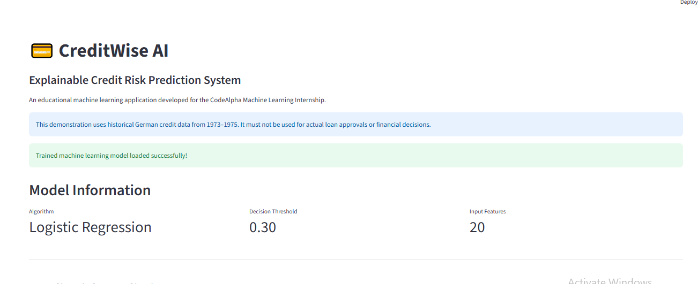
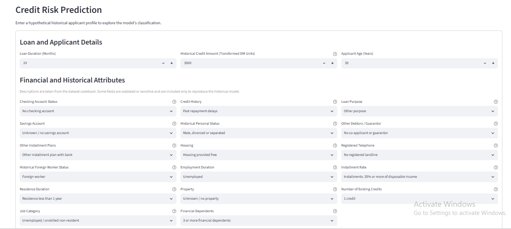
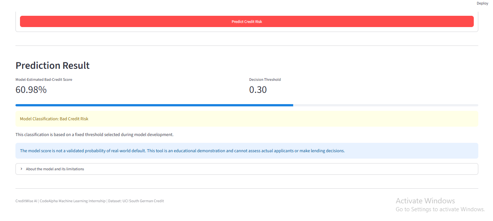
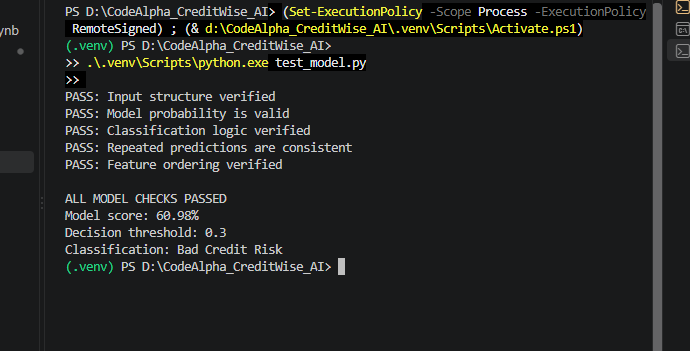

# CreditWise AI — Explainable Credit Risk Prediction System

### CodeAlpha Machine Learning Internship | Project 01

CreditWise AI is an educational machine learning application that demonstrates credit risk classification using historical financial data.

The project includes exploratory data analysis, feature preprocessing, model comparison, decision-threshold optimization, independent evaluation, model interpretation, and an interactive Streamlit interface.

> **Disclaimer:** This project is for educational and portfolio demonstration purposes only. It must not be used for real lending, credit approval, or financial decisions.

---

## Project Objectives

- Explore and analyze historical credit data.
- Develop reproducible machine learning pipelines.
- Compare classification algorithms.
- Evaluate credit-risk predictions using multiple metrics.
- Investigate decision-threshold trade-offs.
- Interpret Logistic Regression model coefficients.
- Build and test an interactive web application.

## Dataset

**Source:** UCI Machine Learning Repository — South German Credit

Dataset link:
https://archive.ics.uci.edu/dataset/573/south+german+credit+

The dataset contains:

- 1,000 observations
- 20 predictor variables
- One binary credit-risk target
- 700 good-credit and 300 bad-credit records

The dataset represents historical German credit information from 1973–1975. The original credit amounts underwent an undocumented transformation.

## Technologies Used

- Python
- Pandas and NumPy
- Scikit-learn
- Matplotlib and Seaborn
- Streamlit
- Joblib
- Google Colab
- Visual Studio Code
- Git and GitHub

## Machine Learning Workflow

1. Dataset loading and validation
2. Exploratory data analysis
3. Numerical and categorical feature processing
4. Stratified training/testing split
5. Baseline model development
6. Logistic Regression and Random Forest comparison
7. Stratified cross-validation
8. Decision-threshold analysis
9. Nested cross-validation for threshold selection
10. Independent test evaluation
11. Model coefficient interpretation
12. Model export and application development

## Independent Test Results

The selected Logistic Regression model was evaluated on 200 held-out records using a fixed decision threshold of 0.30.

| Metric | Test Result |
|---|---:|
| Accuracy | 68.50% |
| Precision | 48.05% |
| Recall | 61.67% |
| F1-score | 0.5401 |
| ROC-AUC | 0.7418 |

**Confusion matrix:**

| Actual / Predicted | Good Credit | Bad Credit |
|---|---:|---:|
| Good Credit | 100 | 40 |
| Bad Credit | 23 | 37 |

The model identified 37 of the 60 bad-credit records in the held-out test set.

These metrics reflect performance on the historical dataset and do not establish suitability for modern lending.

## Application Features

- Interactive Streamlit web interface
- Twenty input features
- Human-readable historical category descriptions
- Model-estimated bad-credit score
- Fixed classification threshold
- Model limitations and educational-use warnings
- Saved preprocessing and classification pipeline

## Project Structure

```text
CodeAlpha_CreditWise_AI/
├── models/
│   └── creditwise_model.joblib
├── notebooks/
│   └── CreditWise_AI_01_Data_Exploration.ipynb
├── app.py
├── inspect_model.py
├── test_model.py
├── requirements.txt
├── .gitignore
└── README.md
```

## Application Screenshots

The following screenshots demonstrate the working CreditWise AI application and its model testing results.

### 1. Application Dashboard



### 2. Credit Risk Input Form



### 3. Credit Risk Prediction Result



### 4. Automated Model Testing



---


## How to Run Locally

**1. Clone the repository**

```bash
git clone <REPOSITORY_URL>
cd CodeAlpha_CreditWise_AI
```

**2. Create a virtual environment**

```bash
python -m venv .venv
```

**3. Install dependencies**

```bash
python -m pip install -r requirements.txt
```

**4. Launch the application**

```bash
python -m streamlit run app.py
```

Open the local URL shown in the terminal.

Python 3.12 was used for local development. The saved model was created using scikit-learn 1.6.1.

## Model Testing

Run the consistency tests:

```bash
python test_model.py
```

The tests examine input structure, prediction score validity, classification logic, repeated prediction consistency, and input feature ordering.

## Model Limitations

- The dataset is historical and does not represent modern lending conditions.
- The sample contains 1,000 records and is not representative of all credit applicants.
- The model is not validated for real-world deployment.
- The score is not a calibrated probability of default.
- Historical demographic and sensitive attributes may introduce fairness concerns.
- Prediction errors include false positives and false negatives.
- The application is strictly an educational demonstration.

## Internship

**Program:** CodeAlpha Machine Learning Internship

**Project:** Credit Scoring Model

**Developer:** Kaunain Gul Khalid

---

Developed as a machine learning portfolio project demonstrating an end-to-end workflow from exploratory analysis to a working application.
